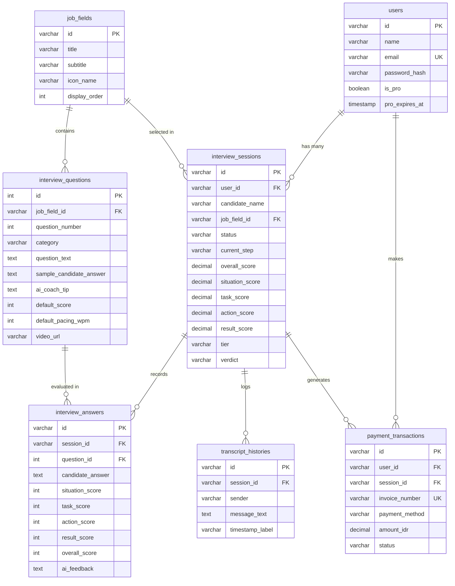

# 🗄️ Database Documentation — InterviewAI

File skema SQL telah disediakan untuk mendukung pengembangan backend dan integrasi database aplikasi **InterviewAI** (Simulasi Interview Kerja Realistis).

---

## 📁 Berkas Database yang Tersedia
1. **[interviewai_schema.sql](../interviewai_schema.sql)** (Root directory) & **[database/schema.sql](./schema.sql)**:
   - DDL skema tabel lengkap beserta *foreign keys*, *indexes*, dan tipe data.
   - Initial Seed Data untuk **6 Bidang Pekerjaan (Job Tracks)**.
   - Initial Seed Data untuk **60 Soal Simulasi Matriks STAR** (lengkap dengan teks pertanyaan, jawaban kandidat, tip AI coach, dan video URL).
   - Seed data contoh pengguna (`users`) dan sesi simulasi (`interview_sessions`).
2. **[database/generate_sql.cjs](./generate_sql.cjs)**:
   - Generator script Node.js jika di masa depan Anda ingin memperbarui soal dari [mockData.ts](../src/data/mockData.ts).

---

## 📊 Struktur Relasi Tabel (Entity Relationship)



---

## 🚀 Cara Import ke Database

### 1. PostgreSQL (Supabase / Neon / Local Postgres)
```bash
psql -h localhost -U postgres -d interviewai_db -f interviewai_schema.sql
```
*Atau buka file `interviewai_schema.sql` lalu copy-paste ke SQL Editor di Supabase / pgAdmin / DBeaver.*

### 2. MySQL / MariaDB
File SQL menggunakan standar ANSI. Untuk MySQL:
- `ON CONFLICT (id) DO NOTHING` dapat diganti menjadi `ON DUPLICATE KEY UPDATE` atau jalankan bagian `CREATE TABLE` terlebih dahulu.
```bash
mysql -u root -p interviewai_db < interviewai_schema.sql
```

